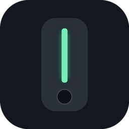
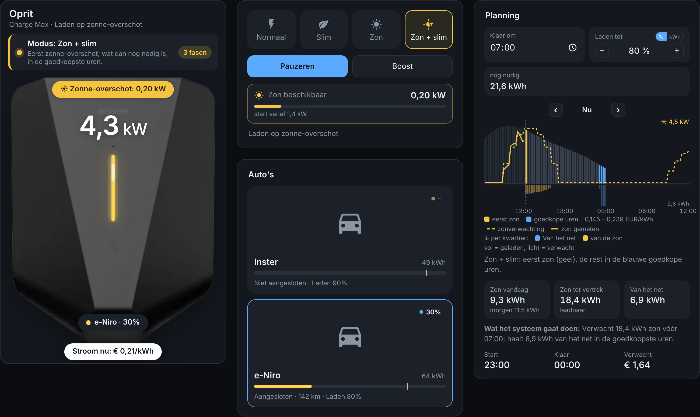

<h1> Easee Smart Charging</h1>

Slim laden, Equalizer-inzicht, laadkosten en een app-achtige dashboardkaart voor je Easee-laadpaal in Home Assistant — gebouwd bovenop de bestaande Easee-integratie. Geen tweede login, geen extra belasting van de Easee-cloud. Hoe werkt slim laden? Je stroom kost elk kwartier een andere prijs. De integratie kijkt naar de prijzen van vandaag en morgen, rekent uit hoeveel stroom je auto nog nodig heeft en laadt dan precies in de goedkoopste uren. Zo is je auto op tijd vol en betaal je zo weinig mogelijk.

[](https://my.home-assistant.io/redirect/hacs_repository/?owner=George-120&repository=ha-easee-smart&category=integration)
[](https://my.home-assistant.io/redirect/config_flow_start/?domain=easee_smart)



**Taal / Language / Sprache:** [Nederlands](#nederlands) · [English](#english) · [Deutsch](#deutsch)

## Nederlands

### Wat het doet

- **Kies gewoon je laadpaal.** De integratie vindt je Easee-laadpalen en Equalizer zelf en herkent het model (Home, Charge, Charge Lite, Max, Up, Core, Pro, One).
- **Slim laden op dynamische prijzen.** De day-ahead beursprijzen (EPEX SPOT, voorheen APX) worden automatisch per kwartier opgehaald voor vandaag en morgen, voor elke Europese prijszone — zonder account of extra integratie. Vul de opslag van je contract in, dan rekent hij met (beurs + opslag + energiebelasting) × (1 + btw). Je stelt een vertrektijd en hoeveel je wilt laden in (kWh, of accupercentage als je auto een accusensor heeft) en de integratie kiest de goedkoopste kwartieren.
- **Laden op zonne-overschot.** Met een Easee Equalizer gebruikt de integratie automatisch de gemeten afname en teruglevering. Zonder Equalizer voeg je je **hoofdaansluiting** toe: je slimme meter (P1) wordt automatisch herkend — HomeWizard P1 heeft voorrang omdat die het nauwkeurigst is, daarna DSMR, P1 Monitor, Zonneplan Connect, Tibber en Enphase, en je kiest je hoofdzekering (bijv. 3×25 A). Achteraf wijzigen kan altijd via *Configureren → Hoofdaansluiting*. Start- en stopvertraging voorkomen pendelen.
- **Zon + slim.** Laadt overdag van de zon en vult het tekort aan in de goedkoopste uren vóór vertrek.
- **Auto's koppelen — elk merk.** Tot zes auto's. Kies het apparaat van je auto (Kia, Hyundai, Tesla, VW, BMW, Polestar, …) en Easee Smart Charging vult automatisch het accuniveau, de stekker-sensor, de laadlimiet, de actieradius en de knoppen om te verversen of het laden te starten in. Alles is aan te passen, inclusief een eigen naam en foto. Met een stekker-sensor per auto kiest hij zelf welke auto aan de laadpaal hangt; je laaddoel wordt ook in de auto gezet.
- **Auto wekken.** Begint een auto niet met laden, dan stuurt Easee Smart Charging na drie minuten een *hervatten* naar de laadpaal en zet de start-entiteit van de auto aan.
- **ERE-regeling.** Zet de ERE-regeling aan en vul in wat je per geladen kWh ontvangt; je ziet de opbrengst per maand, per jaar en totaal (ook in het maandrapport).
- **Boost.** Eén knop om direct op vol vermogen te laden, tot je de stekker eruit haalt.
- **Equalizer uitgelezen.** Netvermogen, stroom per fase (L1/L2/L3), spanning, belasting en resterende ruimte op je hoofdzekering, plus afname/teruglevering in kWh.
- **Kosten en vergoeding.** Kosten per sessie, dag en maand op basis van de echte prijs op dat moment. Optioneel een vergoedingstarief voor leaserijders, met een CSV-maandrapport voor je werkgever.
- **App-achtige kaart.** Een donkere kaart met de lichtstrip van de laadpaal als statuslampje (wit = stand-by, blauw = aangesloten, groen stromend = laden, amber = wacht op goedkoop moment, geel = zon, rood = fout). Tabbladen voor laden, planning met prijsgrafiek, Equalizer en historie.
- **Veilig.** Slimme sturing zet de laadstroom met een vervaltijd van 15 minuten. Valt Home Assistant uit, dan laadt je auto vanzelf weer normaal. Zonder prijsdata laadt hij gewoon direct.
- Nederlands, Engels en Duits.

Load balancing doet de Easee Equalizer zelf; deze integratie grijpt daar niet in.

### Installatie

1. Zorg dat de **Easee-integratie** draait ([nordicopen/easee_hass](https://github.com/nordicopen/easee_hass) via HACS).
2. Installeer **Easee Smart Charging** via HACS (knop hierboven) en herstart Home Assistant.
3. Ga naar *Instellingen → Apparaten & diensten → Integratie toevoegen → Easee Smart Charging* (of gebruik de tweede knop).
4. Kies je laadpaal (en Equalizer), controleer het herkende model, check je hoofdaansluiting (als je geen Equalizer hebt) en vul eventueel de opslag van je energiecontract in. Klaar.

Alle instellingen pas je later aan via *Configureren* op de integratie: laadpaal, hoofdaansluiting, prijzen en kosten (incl. ERE), auto's, en geavanceerd (minimale laadstroom, zonne-vertragingen, zonbuffer, laadrendement, auto verversen, taal).

Vink bij stap 4 *Benodigde Easee-sensoren automatisch inschakelen* aan: een paar Easee-sensoren (fasestromen, spanning, limieten) staan standaard uit.

### De kaart

De kaart wordt automatisch geladen; je hoeft niets aan je dashboard of resources te veranderen. Voeg hem toe via *Kaart toevoegen → Easee Smart Charging*, of in YAML:

```yaml
type: custom:easee-smart-card
entity: sensor.oprit_smart_status   # optioneel; zonder entity pakt hij de eerste laadpaal
tab: charge                         # charge | plan | grid | history
language: auto                      # auto | nl | en | de
```

#### Losse kaarten

Naast de complete kaart zijn er losse kaarten om je dashboard zelf in te delen (allemaal in de kaartkiezer onder *Easee Smart Charging*):

| Kaart | Inhoud |
| --- | --- |
| `custom:easee-smart-charger-card` | Grote laadpaal met vermogen, lichtstrip-status, ERE/kosten en stroomprijs |
| `custom:easee-smart-modes-card` | Laadmodus, Boost en pauzeren/hervatten |
| `custom:easee-smart-cars-card` | Alle auto's met foto en accuniveau; tik om de actieve auto te kiezen |
| `custom:easee-smart-plan-card` | Vertrektijd, laaddoel en prijsgrafiek |
| `custom:easee-smart-grid-card` | Hoofdaansluiting of Equalizer |
| `custom:easee-smart-costs-card` | Kosten, ERE, sessies en export |
| `custom:easee-smart-equalizer-card` | Easee Equalizer: foto, online, afname/teruglevering, fasen, hoofdzekering en meterstanden |

Elke kaart volgt je licht/donker thema (`theme: auto | light | dark`) en heeft een optionele `title`.

### Kant-en-klaar dashboard

Eén druk op de knop en je hebt een compleet **Easee Smart**-dashboard in de zijbalk, met alle kaarten netjes ingedeeld (Laden, Energie & kosten, Alles in één). Je eigen dashboards worden nooit overschreven: is de naam al bezet, dan krijgt het nieuwe dashboard een vrije naam.

- **Instellingen → Apparaten & diensten → Easee Smart Charging → Configureren → Dashboard aanmaken**, of
- de actie `easee_smart.create_dashboard` (alleen voor beheerders).

Nog een keer aanmaken werkt alleen het dashboard bij dat deze integratie zelf heeft gemaakt.

### Entiteiten

| Entiteit | Wat |
| --- | --- |
| `select … laadmodus` | Normaal, Slim, Zon, Zon + slim |
| `time … vertrektijd` | Moment waarop de auto klaar moet zijn |
| `number … te laden energie` / `doel accuniveau` | Hoeveel er bij moet |
| `number … altijd laden onder prijs` | Laad altijd als de prijs hieronder ligt (bijv. negatieve prijzen) |
| `switch … boost` | Nu laden op vol vermogen |
| `sensor … slim laden` | Wat de slimme sturing nu doet |
| `sensor … geplande start / klaar / kosten` | De planning |
| `sensor … kosten vandaag / deze maand / totaal` | Laadkosten |
| `sensor … geladen vandaag / deze maand` | Energie |
| `sensor … vergoeding deze maand` | Als je een vergoedingstarief hebt ingesteld |
| `sensor … netvermogen / zonne-overschot` | Met Equalizer of netsensor |
| `sensor … stroom fase L1-L3 / ruimte / belasting hoofdzekering` | Met Equalizer of fasesensoren van je meter |
| `select … aangesloten auto` | Automatisch of een vaste auto |
| `sensor … accu auto` | Accuniveau van de aangesloten auto |
| `sensor … ERE deze maand / dit jaar / totaal` | Opbrengst van de ERE-regeling |
| `button … gegevens auto verversen` / `laden starten in auto` | Acties op de auto |
| `button … maandrapport exporteren` | Totalen van vorige maand als melding; de CSV download je via de Kosten-kaart of de actie |

Acties: `easee_smart.export_report` (geeft de CSV terug als antwoord; er wordt niets in `/config/www` gezet, want die map is zonder inloggen bereikbaar), `easee_smart.create_dashboard` (alleen beheerders) en `easee_smart.set_mode`.

### Goed om te weten

- **Laadmodi.** *Normaal* laadt meteen op vol vermogen. *Slim* laadt in de goedkoopste uren, zodat de auto op je vertrektijd vol is. *Zon* laadt alleen met zonne-overschot. *Zon + slim* gebruikt eerst zonne-overschot en laadt wat dan nog nodig is in de goedkoopste uren. De kaarten laten altijd zien in welke stand hij staat, op hoeveel fasen, en kleuren de prijsgrafiek per modus.
- **1 of 3 fasen.** Easee-laadpalen laden vanaf 6 A: 1,4 kW op 1 fase, 4,1 kW op 3 fasen. Bij zonneladen wisselt de integratie automatisch: weinig zon → 1 fase, genoeg zon → terug naar 3 fasen (met wachttijd, om de laadpaal te sparen). Uit te zetten onder *Configureren → Laadpaal*.
- **Modus bij een nieuwe sessie** en **gedrag zonder prijzen** stel je in onder *Configureren → Laadpaal*. **Kwartier- of uurprijzen** (standaard kwartier) onder *Prijzen, ERE en kosten*.
- **Easee Equalizer.** Onder *Configureren → Equalizer* kies je je Equalizer (staat al klaar als de Easee-integratie er één kent) en of de kaarten hem tonen: *Automatisch* (zodra er een gekoppeld is), *Tonen* of *Verbergen*. De hoofdkaart laat hem dan zien onder je auto, en er is een losse Equalizer-kaart met alle gegevens.
- Zet in de Easee-app de eigen *slim laden* van Easee uit als je deze integratie de planning laat doen, anders sturen twee systemen tegelijk.
- Sommige auto's vallen in slaap tijdens een lange pauze. De integratie stuurt na drie minuten zonder stroom automatisch een *hervat*-commando.
- Kosten worden gerekend vanaf het moment dat de integratie draait; eerdere sessies staan niet in de historie.

Dit is een communityproject en geen officieel product van Easee.

---

## English

Smart charging, grid connection insight, charging costs and app-style dashboard cards for your Easee charger in Home Assistant — built on top of the existing Easee integration. No second login and no extra load on the Easee cloud. How does smart charging work? Your electricity has a different price every quarter of an hour. The integration looks at today's and tomorrow's prices, works out how much energy your car still needs and charges in exactly the cheapest hours. Your car is full on time and you pay as little as possible.

### What it does

- **Just pick your charger.** The integration finds your Easee chargers and Equalizer by itself and recognises the model (Home, Charge, Charge Lite, Max, Up, Core, Pro, One). Circuit size and main fuse are taken from your Easee settings.
- **Smart charging on dynamic prices.** Day-ahead market prices (EPEX SPOT, formerly APX) are fetched automatically per quarter hour for today and tomorrow, for every European bidding zone — no account or extra integration needed. Enter your contract's markup and it calculates (market + markup + energy tax) × (1 + VAT). Set a departure time and how much you want to charge (kWh, or a battery percentage when your car has a battery sensor) and the integration picks the cheapest quarter hours.
- **Solar surplus charging.** With an Easee Equalizer the measured import and export are used automatically. Without an Equalizer you add your **main connection**: your smart meter is detected automatically — HomeWizard P1 first because it is the most accurate, then DSMR, P1 Monitor, Zonneplan Connect, Tibber and Enphase — and you choose your main fuse (e.g. 3×25 A). You can change it any time under *Configure → Main connection*. Start and stop delays prevent the charger from switching on and off.
- **Solar + smart.** Charges from the sun during the day and tops up the rest in the cheapest hours before departure.
- **Link your cars — any brand.** Up to six cars. Pick your car's device (Kia, Hyundai, Tesla, VW, BMW, Polestar, …) and Easee Smart Charging fills in the battery level, plug sensor, charge limit, range and the buttons to refresh data or start charging. Everything can be changed, including your own name and photo. With a plug sensor per car it detects which car is connected, and your charge target is also set in the car.
- **Wake the car.** If a car does not start charging, Easee Smart Charging sends *resume* to the charger after three minutes and turns on the car's start entity.
- **ERE scheme.** Turn on the ERE scheme (emission reduction units) and enter what you receive per charged kWh; you see the revenue per month, per year and in total (also in the monthly report).
- **Boost.** One button to charge at full power right away, until you unplug.
- **Equalizer values.** Grid power, current per phase (L1/L2/L3), voltage, load and headroom on your main fuse, plus imported/exported energy.
- **Costs and reimbursement.** Costs per session, day and month based on the actual price at that moment. Optionally a reimbursement rate for company-car drivers, with a monthly CSV report for your employer.
- **App-style cards.** The charger's light strip is the status light (white = standby, blue = connected, flowing green = charging, amber = waiting for a cheap moment, yellow = solar, red = error). One complete card plus separate cards for charger, charge mode, cars, planning, grid connection and costs. Light and dark theme.
- **Safe.** Smart control sets the charge current with a 15-minute expiry. If Home Assistant stops, your car simply charges normally again. Without price data it charges right away.
- English, Dutch and German.

Load balancing is done by the Easee Equalizer itself; this integration does not interfere with it.

### Installation

1. Make sure the **Easee integration** is running ([nordicopen/easee_hass](https://github.com/nordicopen/easee_hass) via HACS).
2. Install **Easee Smart Charging** via HACS (button at the top) and restart Home Assistant.
3. Go to *Settings → Devices & services → Add integration → Easee Smart Charging* (or use the second button).
4. Pick your charger (and Equalizer), check the detected model, check your main connection (when you have no Equalizer), optionally enter your energy contract's markup and link a car. Done.

All settings can be changed later under *Configure* on the integration: charger, main connection, prices and costs (incl. ERE), cars, and advanced (minimum charge current, solar delays, solar buffer, charging efficiency, refreshing car data, language).

Tick *Enable the Easee sensors this integration needs* in step 4: a few Easee sensors (phase currents, voltage, limits) are disabled by default.

### The cards

The cards are loaded automatically; you do not have to change your dashboard or resources. Add them via *Add card → Easee Smart Charging*, or in YAML:

```yaml
type: custom:easee-smart-card       # or easee-smart-charger-card, -modes-, -cars-, -plan-, -grid-, -costs-, -equalizer-card
entity: sensor.driveway_smart_status  # optional; without it the first charger is used
theme: auto                          # auto | light | dark
language: auto                       # auto | nl | en | de
```

### Ready-made dashboard

One press and you get a complete **Easee Smart** dashboard in the sidebar, with all cards neatly grouped (Charging, Energy & costs, All in one). Your own dashboards are never overwritten: if the name is taken, the new dashboard gets a free one.

- **Settings → Devices & services → Easee Smart Charging → Configure → Create dashboard**, or
- the action `easee_smart.create_dashboard` (admins only).

Creating it again only refreshes the dashboard this integration made itself.

### Good to know

- **Charge modes.** *Normal* charges right away at full power. *Smart* charges in the cheapest hours so the car is ready at your departure time. *Solar* charges only on solar surplus. *Solar + smart* uses solar surplus first and charges what is still needed in the cheapest hours. The cards always show the active mode and number of phases, and colour the price chart per mode.
- **1 or 3 phases.** Easee chargers charge from 6 A: 1.4 kW on 1 phase, 4.1 kW on 3 phases. For solar charging the integration switches automatically: little sun → 1 phase, enough sun → back to 3 phases (with a delay to spare the charger). Can be turned off under *Configure → Charger*.
- **Mode for a new session** and **what to do without prices** are under *Configure → Charger*. **Quarter-hour or hourly prices** (default quarter hour) under *Prices, ERE and costs*.
- **Easee Equalizer.** Under *Configure → Equalizer* you pick your Equalizer (pre-selected when the Easee integration knows one) and whether the cards show it: *Automatic* (as soon as one is linked), *Show* or *Hide*. The main card then shows it under your car, and there is a separate Equalizer card (`easee-smart-equalizer-card`) with all its data.
- **Monthly report.** The CSV is downloaded from the Costs card, or returned by the action `easee_smart.export_report`. Nothing is stored in `/config/www`, because that folder can be reached without logging in.
- Turn off Easee's own *smart charging* in the Easee app when you let this integration plan, otherwise two systems control the charger at once.
- Costs are counted from the moment the integration runs; earlier sessions are not in the history.

This is a community project and not an official Easee product.

---

## Deutsch

Smartes Laden, Einblick in den Hausanschluss, Ladekosten und App-ähnliche Dashboard-Karten für deine Easee-Wallbox in Home Assistant — aufbauend auf der bestehenden Easee-Integration. Kein zweites Login und keine zusätzliche Last für die Easee-Cloud. Wie funktioniert smartes Laden? Strom kostet jede Viertelstunde einen anderen Preis. Die Integration schaut sich die Preise von heute und morgen an, rechnet aus, wie viel Strom dein Auto noch braucht, und lädt genau in den günstigsten Stunden. So ist dein Auto rechtzeitig voll und du zahlst so wenig wie möglich.

### Was es macht

- **Einfach die Wallbox wählen.** Die Integration findet deine Easee-Wallboxen und den Equalizer selbst und erkennt das Modell (Home, Charge, Charge Lite, Max, Up, Core, Pro, One). Absicherung und Hauptsicherung werden aus deinen Easee-Einstellungen übernommen.
- **Smartes Laden mit dynamischen Preisen.** Die Day-Ahead-Börsenpreise (EPEX SPOT) werden automatisch je Viertelstunde für heute und morgen abgerufen, für jede europäische Preiszone — ohne Konto oder zusätzliche Integration. Trage den Aufschlag deines Vertrags ein, dann rechnet sie mit (Börse + Aufschlag + Energiesteuer) × (1 + MwSt.). Du legst eine Abfahrtszeit und die gewünschte Lademenge fest (kWh oder Akkustand, wenn dein Auto einen Akkusensor hat) und die Integration wählt die günstigsten Viertelstunden.
- **Laden mit Solarüberschuss.** Mit einem Easee Equalizer werden Bezug und Einspeisung automatisch genutzt. Ohne Equalizer fügst du deinen **Hausanschluss** hinzu: dein Smart Meter wird automatisch erkannt — HomeWizard P1 zuerst, weil er am genauesten ist, danach DSMR, P1 Monitor, Zonneplan Connect, Tibber und Enphase — und du wählst deine Hauptsicherung (z. B. 3×25 A). Änderungen jederzeit unter *Konfigurieren → Hausanschluss*. Start- und Stoppverzögerungen verhindern ständiges Ein- und Ausschalten.
- **Solar + Smart.** Lädt tagsüber mit Sonnenstrom und füllt den Rest in den günstigsten Stunden vor der Abfahrt auf.
- **Autos verbinden — jede Marke.** Bis zu sechs Autos. Wähle das Gerät deines Autos (Kia, Hyundai, Tesla, VW, BMW, Polestar, …) und Easee Smart Charging trägt Akkustand, Stecker-Sensor, Ladelimit, Reichweite und die Tasten zum Aktualisieren oder Starten des Ladens selbst ein. Alles ist anpassbar, auch Name und Foto. Mit einem Stecker-Sensor pro Auto erkennt sie, welches Auto angeschlossen ist; dein Ladeziel wird auch im Auto gesetzt.
- **Auto wecken.** Lädt ein Auto nicht, sendet Easee Smart Charging nach drei Minuten *Fortsetzen* an die Wallbox und schaltet die Start-Entität des Autos ein.
- **ERE (Emissionsminderung).** Schalte die ERE-Erfassung ein und trage ein, was du pro geladener kWh erhältst; du siehst den Erlös pro Monat, pro Jahr und gesamt (auch im Monatsbericht).
- **Boost.** Eine Taste, um sofort mit voller Leistung zu laden, bis du absteckst.
- **Equalizer-Werte.** Netzleistung, Strom pro Phase (L1/L2/L3), Spannung, Auslastung und Reserve der Hauptsicherung sowie Bezug/Einspeisung in kWh.
- **Kosten und Erstattung.** Kosten pro Ladevorgang, Tag und Monat auf Basis des tatsächlichen Preises. Optional ein Erstattungssatz für Dienstwagenfahrer mit monatlichem CSV-Bericht für den Arbeitgeber.
- **App-ähnliche Karten.** Der Lichtstreifen der Wallbox ist die Statusanzeige (weiß = Standby, blau = verbunden, fließend grün = lädt, bernstein = wartet auf günstigen Moment, gelb = Solar, rot = Fehler). Eine Gesamtkarte plus einzelne Karten für Wallbox, Lademodus, Autos, Planung, Hausanschluss und Kosten. Helles und dunkles Design.
- **Sicher.** Die smarte Steuerung setzt den Ladestrom mit 15 Minuten Ablaufzeit. Fällt Home Assistant aus, lädt dein Auto einfach wieder normal. Ohne Preisdaten wird sofort geladen.
- Deutsch, Englisch und Niederländisch.

Das Lastmanagement übernimmt der Easee Equalizer selbst; diese Integration greift nicht ein.

### Installation

1. Stelle sicher, dass die **Easee-Integration** läuft ([nordicopen/easee_hass](https://github.com/nordicopen/easee_hass) über HACS).
2. Installiere **Easee Smart Charging** über HACS (Taste oben) und starte Home Assistant neu.
3. Gehe zu *Einstellungen → Geräte & Dienste → Integration hinzufügen → Easee Smart Charging* (oder nutze die zweite Taste).
4. Wähle deine Wallbox (und den Equalizer), prüfe das erkannte Modell und den Hausanschluss (ohne Equalizer), trage optional den Aufschlag deines Stromvertrags ein und verbinde ein Auto. Fertig.

Alle Einstellungen änderst du später unter *Konfigurieren*: Wallbox, Hausanschluss, Preise und Kosten (inkl. ERE), Autos und Erweitert (minimaler Ladestrom, Solar-Verzögerungen, Solarpuffer, Ladewirkungsgrad, Autodaten aktualisieren, Sprache).

Aktiviere in Schritt 4 *Benötigte Easee-Sensoren automatisch aktivieren*: einige Easee-Sensoren (Phasenströme, Spannung, Grenzen) sind standardmäßig deaktiviert.

### Die Karten

Die Karten werden automatisch geladen; du musst nichts an deinem Dashboard oder den Ressourcen ändern. Füge sie über *Karte hinzufügen → Easee Smart Charging* hinzu oder per YAML:

```yaml
type: custom:easee-smart-card       # oder easee-smart-charger-card, -modes-, -cars-, -plan-, -grid-, -costs-card
theme: auto                          # auto | light | dark
language: auto                       # auto | nl | en | de
```

### Fertiges Dashboard

Ein Knopfdruck und du hast ein komplettes **Easee Smart**-Dashboard in der Seitenleiste, mit allen Karten übersichtlich gruppiert (Laden, Energie & Kosten, Alles in einem). Deine eigenen Dashboards werden nie überschrieben: ist der Name vergeben, bekommt das neue Dashboard einen freien Namen.

- **Einstellungen → Geräte & Dienste → Easee Smart Charging → Konfigurieren → Dashboard erstellen**, oder
- die Aktion `easee_smart.create_dashboard` (nur Administratoren).

Erneut erstellen aktualisiert nur das Dashboard, das diese Integration selbst angelegt hat.

### Gut zu wissen

- **Lademodi.** *Normal* lädt sofort mit voller Leistung. *Smart* lädt in den günstigsten Stunden, damit das Auto zur Abfahrt voll ist. *Solar* lädt nur mit Solarüberschuss. *Solar + Smart* nutzt zuerst Solarüberschuss und lädt den Rest in den günstigsten Stunden. Die Karten zeigen immer den aktiven Modus und die Phasenzahl und färben die Preisgrafik je Modus.
- **1 oder 3 Phasen.** Easee-Wallboxen laden ab 6 A: 1,4 kW einphasig, 4,1 kW dreiphasig. Beim Solarladen schaltet die Integration automatisch um: wenig Sonne → 1 Phase, genug Sonne → zurück auf 3 Phasen (mit Verzögerung, um die Wallbox zu schonen). Abschaltbar unter *Konfigurieren → Wallbox*.
- **Modus bei neuer Ladesitzung** und **Verhalten ohne Preise** unter *Konfigurieren → Wallbox*. **Viertelstunden- oder Stundenpreise** (Standard Viertelstunde) unter *Preise, ERE und Kosten*.
- **Easee Equalizer.** Unter *Konfigurieren → Equalizer* wählst du deinen Equalizer (vorausgewählt, wenn die Easee-Integration einen kennt) und ob die Karten ihn zeigen: *Automatisch* (sobald einer verbunden ist), *Anzeigen* oder *Ausblenden*. Die Hauptkarte zeigt ihn dann unter deinem Auto, und es gibt eine eigene Equalizer-Karte (`easee-smart-equalizer-card`) mit allen Daten.
- **Monatsbericht.** Die CSV lädst du über die Kosten-Karte herunter, oder du bekommst sie als Antwort der Aktion `easee_smart.export_report`. Nichts wird in `/config/www` gespeichert, denn dieser Ordner ist ohne Anmeldung erreichbar.
- Schalte das eigene *Smart Charging* von Easee in der Easee-App aus, wenn diese Integration plant, sonst steuern zwei Systeme gleichzeitig.
- Kosten werden ab dem Moment gezählt, in dem die Integration läuft.

Dies ist ein Community-Projekt und kein offizielles Produkt von Easee.

---

## Bronnen / Sources / Quellen

Prijsdata / price data / Preisdaten: [Energy-Charts](https://energy-charts.info) (Fraunhofer ISE), licentie CC BY 4.0.

## Licentie / License / Lizenz

MIT
